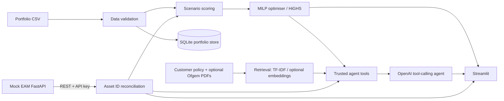
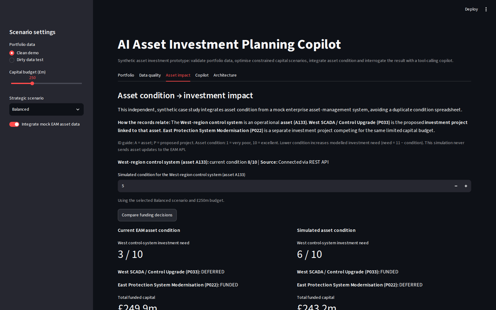

# AI Asset Investment Planning Copilot

[](https://github.com/callumkealey/asset-investment-copilot/actions/workflows/tests.yml)

**From operational asset condition to a defensible capital-investment decision.**

A self-directed, synthetic technical project exploring how an asset-intensive organisation could use operational asset data to inform capital-investment decisions. It combines an investment portfolio, an external asset-management feed, deterministic prioritisation, budget-constrained optimisation, document retrieval and a tool-calling AI copilot in one Streamlit application. The implementation takes inspiration from forward-deployed engineering: start with a concrete decision, build a working vertical slice, then test how new operational data affects the outcome.

The central question is: **if the condition of an operational asset changes, does the investment plan change—and can we explain why?**

> **Scope and attribution:** This is an independent synthetic demonstration, not a customer implementation or a commercial asset-planning product. It uses no confidential client data and is not affiliated with any vendor, utility or regulator. Public Ofgem documents, when downloaded, are used as attributable reference material, not as proof of regulatory approval or compliance.

## At a glance

| Capability | Implementation | Business purpose |
| --- | --- | --- |
| Data-quality controls | Python validation and asset-ID reconciliation | Avoid recommendations based on invalid or unmatched records |
| Transparent prioritisation | Configurable scenario weights | Show why projects are ranked differently |
| Capital allocation | SciPy/HiGHS mixed-integer optimisation | Select a portfolio within a capital budget, including mandatory projects |
| External asset integration | FastAPI mock EAM service, REST client, API key | Incorporate condition data from a simulated system of record |
| What-if analysis | Streamlit **Asset impact** tab | Recalculate funding decisions without modifying EAM asset records |
| AI decision support | OpenAI tool-calling agent | Explain trusted model outputs and retrieve supporting evidence |
| Evidence retrieval | Local TF-IDF; optional embeddings | Distinguish source material from calculated investment results |
| Regression coverage | 15 pytest tests in the latest verified run | Detect changes that break critical controls or funding behaviour |

## Demonstrated outcome: condition change alters capital allocation

The reproducible demonstration uses **40 synthetic investment candidates**, the **Balanced** strategy and a **£250m** capital budget. A133 is a West-region control-system asset linked to **P033 — West SCADA / Control Upgrade 33**.

With the same portfolio, budget, scenario and inspection date, changing **only** A133's condition score from **8 to 5** changes P033's calculated priority and the optimiser's funding selection:

| Measure | Baseline: A133 = 8 | What-if: A133 = 5 | Difference |
| --- | ---: | ---: | ---: |
| P033 priority score | 5.850 | 6.300 | +0.450 |
| P033 funding | Deferred | **Funded** | Enters programme |
| P022 funding | **Funded** | Deferred | Leaves programme |
| Funded project count | 16 | 16 | Unchanged |
| Total funded capex | £249.9m | £243.2m | −£6.7m |
| Portfolio objective score | 93.825 | 93.900 | +0.075 |

P022 is **East Protection System Modernisation 22**, with £25.7m capex and a 6.225 priority score. P033 has £19.0m capex. Both cases satisfy the £250m budget in the observed run.

**Interpretation:** The condition input changes the modelled need for P033; the optimiser then selects a different combination of investments. The £6.7m difference is **less capital allocated in this model run**, not a realised saving or benefit forecast. The 0.075 improvement is in the synthetic **priority-score objective**, not a financial return measure. The scenario demonstrates sensitivity and reproducibility within the prototype; it is not independent validation of real-world asset-risk outcomes.

The change was reproduced both through the mock REST-connected Streamlit workflow and through a condition-only controlled test. The what-if tab changes an **in-memory copy** and sends **no asset update request** to the mock EAM API. The application may still refresh its local SQLite portfolio store during normal Streamlit reruns; the entire application is not represented as transactionally read-only.

## Architecture



**Engineering boundaries**

- **Python owns the decisions.** Validation, scenario scoring, mandatory-project checks and mixed-integer capital optimisation are deterministic and independently testable. The language model does not invent the allocation maths.
- **The EAM feed is an integration boundary.** The mock FastAPI service supports asset retrieval and demo mutation/reset operations; the client reconciles `asset_id` values to portfolio projects. The UI identifies when REST is unavailable and a local asset-data fallback is used.
- **RAG supplies context, not numerical authority.** Retrieved policy or regulatory passages support explanations. Synthetic customer policy must not be confused with Ofgem determinations or binding obligations.
- **A single agent is sufficient.** The workflow uses explicit tools and exposes a tool trace rather than introducing multiple coordinating agents for a compact task.
- **Human approval remains essential.** Outputs are planning recommendations, not autonomous capital approvals.

### Technology

Python, pandas, Streamlit, FastAPI, requests, SQLite, SciPy/HiGHS, pytest and the OpenAI Responses API. The document retriever defaults to TF-IDF; an optional embeddings mode is available through environment configuration.

## Problem framing and implementation approach

A fictional transmission organisation has more candidate projects than available capital. Reliability, regulatory drivers, network capacity, carbon, customer impact, project maturity and asset condition compete for funding. Planners need a transparent basis for funding and deferral, with a way to test new evidence.

This is a **personal exploration of the problem and the engineering trade-offs**, rather than work commissioned by a customer. The fictional stakeholder request below is a design exercise used to test how the architecture responds to a realistic integration requirement.

**Iteration 1 — establish a working decision model:** import the portfolio, enforce data-quality rules, compare four strategic scoring scenarios, optimise the funded set against a budget, persist project data in SQLite and explain the results with the Copilot.

**Hypothetical stakeholder requirement:**

> “Our asset condition changes regularly and lives in our enterprise asset-management system. We do not want planners maintaining another spreadsheet.”

**Iteration 2 — incorporate external operational data:** add an API-key-protected mock EAM REST service, reconcile assets to proposed projects, display data-quality exceptions, expose an asset lookup tool to the agent and incorporate condition changes into investment scoring.

**Iteration 3 — test sensitivity and explainability:** implement a controlled A133 condition-change regression test, an interactive in-memory before/after comparison, and a 15-run sensitivity grid over five asset conditions and three capital budgets.

The detailed change request and enterprise considerations are documented in `docs/customer_change_request.md` and `docs/productionisation.md`.

## Strategy and optimiser

The predefined scenarios are:

| Scenario | Emphasis |
| --- | --- |
| **Balanced** | Broad balance of criticality, regulatory, capacity, customer, carbon, maturity and asset condition factors |
| **Reliability First** | Asset criticality and condition |
| **Net Zero** | Carbon and network enablement |
| **Regulatory Compliance** | Regulatory drivers |

Weights are defined in `src/scenarios.py`. The optimiser uses binary project decisions to maximise the **sum of priority scores**, subject to a **capital budget** and selection of **mandatory projects**. See `src/scoring.py` and `src/optimiser.py` for the implemented logic. Priority scores are relative model weights, not monetised benefits or discounted cash flows.

## Data quality and external integration

The repository includes `data/investment_portfolio_clean.csv` and a deliberately invalid `data/investment_portfolio_dirty.csv`. The dirty extract illustrates duplicate IDs, missing fields, negative capex and out-of-range scores; the application blocks optimisation when validation fails.

The synthetic asset feed also exercises mismatches, absent condition data and older inspection dates. Reconciliation and status outputs make these limitations visible instead of silently assuming perfect data. The app reports whether it is using **REST** or a **local fallback**; the fallback is useful for demonstration but should not be mistaken for a live external-system read.

The mock service's asset read and controlled demo-update/reset endpoints are exposed in its local FastAPI documentation at `http://127.0.0.1:8001/docs`. Its API key is a **prototype-only shared secret**, not enterprise-grade identity management.

## AI copilot and supporting documents

The single tool-calling agent can use:

| Tool | Function |
| --- | --- |
| `get_project(project_id)` | Inspect a portfolio project |
| `get_asset(asset_id)` | Retrieve an individual asset from the mock EAM API and show linked portfolio projects |
| `run_budget_scenario(budget_m, scenario)` | Calculate a funded investment portfolio |
| `compare_scenarios(budget_m, scenario_a, scenario_b)` | Compare allocations under strategic weightings |
| `check_data_quality()` | Report validation and reconciliation issues |
| `search_documents(query, top_k)` | Retrieve relevant text from indexed evidence |

Tool outputs are surfaced through a trace in the **Copilot** tab. The `get_asset` tool is a **read** operation; missing fields and undocumented scoring scales should not be inferred by the agent.

A synthetic customer investment policy is included. The optional `scripts/fetch_public_docs.py` script retrieves two public regulatory documents:

- [Ofgem RIIO-3 Final Determinations — Electricity Transmission](https://www.ofgem.gov.uk/sites/default/files/2025-12/RIIO-3-Final-Determinations-ET.pdf)
- [Ofgem RIIO-3 Final Determinations — Scottish Hydro Electric Transmission (SHET)](https://www.ofgem.gov.uk/sites/default/files/2025-12/RIIO-3-Final-Determinations-SHET.pdf)

The retrieval layer is not a regulatory compliance engine. Source provenance, document date and the distinction between customer assumptions and regulatory text remain important when interpreting answers.

## Run locally (Windows / VS Code)

The application was developed using Python in Visual Studio Code on Windows. The following instructions use PowerShell commands, which can be run either in the VS Code integrated terminal or in a standalone PowerShell window.

Run commands from the project root, the directory containing
`app.py`, `src/`, `tests/` and `requirements.txt`.

### 1. Set up the virtual environment

```powershell
py -m venv .venv
.\.venv\Scripts\Activate.ps1
python -m pip install -r requirements.txt
```

### 2. Configure environment variables

For a first-time setup only, copy the example configuration:

```powershell
Copy-Item .env.example .env
```

Edit `.env` locally. Set `OPENAI_API_KEY` to enable AI agent calls and configure the mock EAM URL/API key as needed. **Do not commit `.env` or API secrets.** Deterministic scoring, optimisation, API integration and local retrieval can run without an OpenAI key. If using optional document embeddings, configure `USE_OPENAI_EMBEDDINGS=true` and the corresponding API access.

### 3. Optional: fetch public evidence

```powershell
python scripts\fetch_public_docs.py
```

### 4. Terminal 1 — start the mock EAM service

```powershell
python -m uvicorn api.mock_eam:app --host 127.0.0.1 --port 8001
```

Leave this terminal running. The service's interactive API documentation is available at `http://127.0.0.1:8001/docs`.

### 5. Terminal 2 — start Streamlit

Open a **second** PowerShell terminal, return to the project root, activate `.venv` if necessary, then run:

```powershell
python -m streamlit run app.py
```

Open the local URL Streamlit prints (normally `http://localhost:8501`). The sidebar controls portfolio data mode, budget, scenario and EAM integration.

### 6. Run automated tests

```powershell
python -m pytest -q
```

The latest locally verified run reported **15 passed**. GitHub Actions also runs the pytest suite on **Python 3.13 / Ubuntu** after pushes to `main` and on pull requests. The automated suite uses checked-in synthetic data and mocks; it does not require a running EAM server or an OpenAI API key. Re-run locally before pushing changes.

For a separate manual, REST-connected condition-impact check, keep the EAM API running and execute:

```powershell
python -u -m scripts.condition_impact_check
```

The automated regression test in `tests/test_condition_impact.py` instead reads baseline seed data and does **not** require an API server.

## Sensitivity analysis: condition × budget

The standalone script explores how funding depends jointly on **asset condition** and **available capital**. It compares five A133 condition scores (8, 7, 6, 5, 4) across three budgets (£200m, £250m, £300m), holding other portfolio inputs and the **Balanced** strategy constant.

```powershell
python -m scripts.sensitivity_analysis
```

It writes `reports/sensitivity_analysis.csv` and `reports/sensitivity_findings.md`. The script reads the checked-in synthetic asset seed, calls the existing deterministic scoring and optimiser, and **does not call the EAM API, OpenAI or SQLite**.

| Budget | Condition sensitivity observed for P033 |
| --- | --- |
| £200m | Deferred at all five tested conditions |
| £250m | Deferred at conditions 8, 7 and 6; funded at 5 and 4 |
| £300m | Funded at all five tested conditions |

At £250m, P033 replaces P022 as the condition changes between **6 and 5**. This is a **sampled decision threshold within the synthetic model**, not a validated real-world engineering threshold. At £200m the capital constraint prevents P033's funding at every tested condition, while at £300m both projects remain funded.

For full outputs, see the generated CSV and Markdown report, and `docs/sensitivity_analysis.md`. The exact threshold and selected portfolio depend on scoring weights, costs and constraints. The analysis tests *sensitivity*, not the empirical calibration or external validity of the scoring model.

## Screenshot

Once you have captured the final Streamlit interface, save a genuine screenshot at `docs/Images/asset-impact.png`. This README uses a relative link so the image displays on GitHub:



_Illustrative synthetic data. No real customer capital decision or realised financial saving is claimed._

## Explore the prototype

A useful way to explore the implementation and trace the decision logic is to follow this sequence:

1. **Portfolio:** choose **Clean demo**, **Balanced**, **£250m** and enable the EAM integration. Confirm the status is **REST**, not **Fallback**. Show the funded and deferred investments.
2. **Asset impact:** use **Reset demo to baseline** if needed; note that reset deliberately updates the synthetic EAM records. In **Asset impact**, confirm A133 starts at condition 8. Set the *simulated* condition to 5 and select **Compare funding decisions**. Show P033 entering, P022 leaving, £249.9m → £243.2m and 93.825 → 93.900. This comparison does not update the EAM record.
3. **Copilot:** ask the agent to retrieve A133 or run a £250m Balanced scenario. Expand the tool trace to show that data and calculations came from tools, not invented text. For document questions, inspect the retrieved source and page/section context.
4. **Data quality:** switch to the **Dirty data test** extract and demonstrate that invalid inputs block optimisation; switch back to Clean demo afterwards.
5. **Architecture and limitations:** explain the REST integration boundary, deterministic optimiser, retrieval layer, and where production engineering would be required.

**Suggested Copilot prompts:**

- “Retrieve asset A133, show its condition and the portfolio project linked to it. Do not infer missing metadata.”
- “With a £250m budget under Balanced, which projects are funded and what are the trade-offs?”
- “Compare Balanced and Net Zero at £220m. Which projects enter or leave the portfolio?”
- “What portfolio data-quality issues would block a recommendation?”
- “What does the supporting Ofgem material actually say about the relevant risk or investment issue? Cite the source.”

## Testing and evidence

The pytest suite covers portfolio validation, optimiser constraints, mandatory investments, scoring behaviour, API access controls, the agent's `get_asset` integration and the **condition-only funding-switch regression**. In the controlled condition test, the seed assets are copied in memory; the test verifies the expected P022/P033 funding exchange without requiring REST or changing source files.

**Evidence verified in the prototype:** 40 portfolio candidates, 39 asset records returned by the live mock API, successful individual-asset retrieval for A133, a **15-test passing suite**, a **15-combination sensitivity matrix**, and the reproduced £250m Balanced condition-impact comparison.

**Boundaries of the evidence:** These are synthetic, local results. Test success does not demonstrate enterprise reliability, production security, regulatory compliance or independently validated asset-health models.

## Production path and limitations

This is an **MVP**, not a production asset-investment platform. Priorities for a real deployment include:

- Replace the mock EAM API with a supported enterprise integration, including formal schema contracts, service identity, least-privilege authorisation and secrets management.
- Establish data ownership, quality SLAs, inspection-date semantics, condition-score direction/scale, reconciliation rules, freshness thresholds and lineage.
- Validate scoring weights, constraint logic, investment horizons, dependencies and economic objectives with planners and asset engineers; extend the prototype sensitivity tests to uncertainty analysis and documented model governance.
- Implement retry/backoff, timeouts, monitoring, audit logs, idempotency, durable scenario records, failure alerts and disaster-recovery controls.
- Harden retrieval and agent execution against prompt injection, unsupported claims and disclosure of sensitive enterprise records; evaluate source attribution and response accuracy.
- Add CI/CD, deployment configuration, automated integration/security tests, RBAC, approval workflow and controlled write operations.

See `docs/productionisation.md` for the fuller production-gap assessment.

## Repository map

```text
.
├── app.py                           # Streamlit UI, including Asset impact
├── api/
│   └── mock_eam.py                 # Mock EAM REST API
├── data/
│   ├── investment_portfolio_clean.csv
│   ├── investment_portfolio_dirty.csv
│   ├── assets.csv
│   ├── assets_seed.csv             # Stable assets for controlled tests
│   └── documents/                 # Customer policy and optional Ofgem PDFs
├── src/
│   ├── agent.py                    # OpenAI tool-calling orchestration
│   ├── tools.py                    # Trusted portfolio/retrieval/asset tools
│   ├── eam_client.py               # EAM REST client
│   ├── data_loader.py
│   ├── validation.py
│   ├── scoring.py
│   ├── optimiser.py                # SciPy/HiGHS MILP
│   ├── scenarios.py
│   ├── retrieval.py
│   └── database.py                 # SQLite portfolio store
├── scripts/
│   ├── condition_impact_check.py   # Manual REST-connected check
│   ├── sensitivity_analysis.py    # 15-run condition/budget grid
│   ├── fetch_public_docs.py
│   └── generate_data.py
├── tests/
│   ├── test_condition_impact.py    # Condition-only funding regression
│   ├── test_asset_tool.py          # Asset tool tests
│   ├── test_sensitivity_analysis.py # Deterministic sensitivity tests
│   └── ...
├── docs/
│   ├── customer_change_request.md
│   ├── sensitivity_analysis.md
│   ├── images/asset-impact.png     # Genuine screenshot of synthetic what-if UI
│   ├── productionisation.md
│   └── ...
├── requirements.txt
└── .env.example
```

## What this project demonstrates

The purpose of this project is to make the **reasoning, design decisions and implementation logic** visible. It is not presented as a commercial deployment or a replacement for a regulated investment-planning platform.

The approach is to **define the decision → build a small working system → establish data and integration boundaries → test a realistic change in requirements → measure the resulting decision impact → document trade-offs and production gaps**.

The strongest result is not an AI-generated answer: it is that a **controlled change in operational asset condition produces a reproducible, explainable change in a budget-constrained investment selection**. The documentation and tests are intended to let others inspect, reproduce and challenge that logic.
