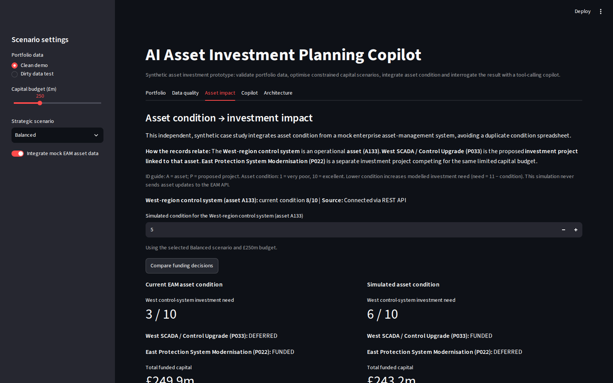
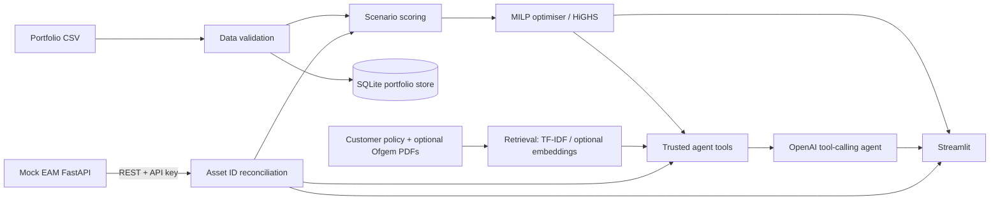

# Asset Investment Planning Copilot

I built a Python and Streamlit prototype to answer a capital planning question for a fictional electricity transmission operator. If an asset’s condition deteriorates, which projects should receive funding, and can a planner trace why the allocation changed?

**[Open the live demo](https://asset-investment-copilot.streamlit.app/)** · [Reproduce the result](#reproduce-the-result) · [View the test workflow](https://github.com/callumkealey/asset-investment-copilot/actions/workflows/tests.yml)

## Case study — One asset condition change switches funding

With 40 synthetic project candidates, a £250m budget and the Balanced strategy, I lowered the condition score of control-system asset A133 from 8 to 5 while holding the inspection date and all other inputs constant. Its linked SCADA upgrade, P033, entered the funded portfolio and a separate protection modernisation project, P022, was deferred.

| Measure | A133 at 8 | A133 at 5 |
| --- | ---: | ---: |
| P033 priority score | 5.850 | 6.300 |
| P033 SCADA upgrade | Deferred | Funded |
| P022 protection modernisation | Funded | Deferred |
| Projects funded | 16 | 16 |
| Allocated capital | £249.9m | £243.2m |
| Portfolio priority-score objective | 93.825 | 93.900 |

The lower condition score increased P033’s modelled investment need. The optimiser selected a different project mix under the same budget. The £6.7m difference measures lower allocation in this synthetic run. The objective measures the sum of project priority scores. The model measures portfolio selection, with financial benefits outside its scope.

**Try it in the demo.** Select **Clean demo**, **Balanced** and **£250m**. Enable EAM integration and check for **REST** status. In **Asset impact**, check that A133’s baseline is 8, set the simulated condition to 5 and select **Compare funding decisions**. The comparison runs in memory. The hosted mock API serves asset records in read-only mode. The AI Copilot requires a separately supplied access code.



## What I built

- **REST integration and data quality.** Streamlit reads from a separately deployed mock enterprise asset-management (EAM) service on Render. The app reconciles asset IDs to projects, shows when it uses the local fallback and blocks optimisation when portfolio validation fails. [FastAPI service](api/mock_eam.py) · [API-key-authenticated REST client](src/eam_client.py)
- **Analytics and optimisation.** Configurable scenario weights produce project priority scores. A SciPy/HiGHS mixed-integer optimiser maximises their sum subject to the capital budget and mandatory-project constraints. A 15-run sensitivity grid tests the funding decision across five conditions and three budgets. [Scenario weights](src/scenarios.py) · [Optimiser](src/optimiser.py)
- **AI decision support.** An OpenAI tool-calling agent looks up assets, runs or compares scenarios and retrieves supporting passages. Python calculates the funding decisions. The Copilot shows its tool trace so reviewers can inspect the basis for an explanation. [Agent](src/agent.py) · [Tools](src/tools.py)

**Scope.** This is an independent portfolio prototype with a mock integration and fictional project, cost and condition data. The scores and allocations are illustrative. Real-world use would require validation with planners and asset engineers.

## Reproduce the result

Follow [Run locally](#run-locally) to install dependencies, then run:

```powershell
python -m pytest -q
```

The latest documented local run reported **15 passing tests**. The [condition-impact regression](tests/test_condition_impact.py) uses the [checked-in asset seed](data/assets_seed.csv) and verifies the P033/P022 funding switch without an API server or OpenAI key. The suite also covers validation, scoring, optimiser constraints, mandatory projects, API access controls and agent asset lookup. [GitHub Actions](https://github.com/callumkealey/asset-investment-copilot/actions/workflows/tests.yml) runs pytest on Python 3.13 and Ubuntu.

For the separate REST-connected check, start the mock EAM service and run:

```powershell
python -u -m scripts.condition_impact_check
```

The screenshot shows the Streamlit workflow with the local mock API and checked-in synthetic data. [Screenshot capture script](scripts/capture_asset_impact.py)

## Sensitivity analysis

Across five tested A133 condition scores, P033 was deferred throughout at £200m and funded throughout at £300m. At £250m it switched from deferred at 6 to funded at 5. That is a sampled switch under the Balanced model’s weights, costs and constraints.

```powershell
python -m scripts.sensitivity_analysis
```

The script reads the checked-in asset seed and runs the deterministic scoring and optimiser independently of the EAM API, OpenAI and SQLite. It writes [the results CSV](reports/sensitivity_analysis.csv) for all 15 combinations and a [findings report](reports/sensitivity_findings.md). See the [sensitivity analysis method](docs/sensitivity_analysis.md).

## Architecture and data



<details>
<summary>Scoring and strategy</summary>

The predefined scenarios are:

| Scenario | Emphasis |
| --- | --- |
| **Balanced** | Broad balance of criticality, regulatory, capacity, customer, carbon, maturity and asset condition factors |
| **Reliability First** | Asset criticality and condition |
| **Net Zero** | Carbon and network enablement |
| **Regulatory Compliance** | Regulatory drivers |

Weights are defined in [src/scenarios.py](src/scenarios.py). The optimiser uses binary project decisions to maximise the **sum of priority scores**, subject to a **capital budget** and selection of **mandatory projects**. See [src/scoring.py](src/scoring.py) and [src/optimiser.py](src/optimiser.py) for the implemented logic. Priority scores are relative model weights, not monetised benefits or discounted cash flows.

</details>

<details>
<summary>Synthetic data and validation</summary>

**All project, financial, asset-condition and inspection values in the demonstration are fictional.** They are not customer extracts, real utility asset records or calibrated engineering-risk estimates. The datasets were designed to exercise a realistic *data workflow and investment decision*, not to represent a real network.

### How the data was created

[`scripts/generate_data.py`](scripts/generate_data.py) creates the core CSV files using Python's `random` module with fixed seeds (**42** for the investment portfolio and **43** for the linked assets). The generator:

1. Creates **40 candidate investment projects** (`P001`–`P040`), each with an associated asset ID, project type, region, illustrative capital cost, strategic scoring inputs, delivery risk, maturity and a rule-based mandatory flag.
2. Creates **39 mock EAM asset records**, linked to projects by `asset_id`. One asset is intentionally absent (`A134`, linked to `P034`); the condition value for `A122` is deliberately missing; and some inspection dates are older. These are test cases for reconciliation and missing-data handling.
3. Produces a separate **dirty portfolio** by injecting invalid capital costs, an out-of-range criticality value, missing fields and a duplicate project ID.

The fixed seeds make the scripted data generation repeatable. The asset-condition scores, costs and strategic inputs are illustrative assumptions, **not predictions or measurements**.

### Files and their roles

| File | Purpose |
| --- | --- |
| [`investment_portfolio_clean.csv`](data/investment_portfolio_clean.csv) | 40 valid synthetic investment candidates used for scenario scoring and capital optimisation |
| [`investment_portfolio_dirty.csv`](data/investment_portfolio_dirty.csv) | Intentionally invalid version used to demonstrate validation failures and blocked optimisation |
| [`assets.csv`](data/assets.csv) | Working asset dataset read by the mock EAM REST API, or by the local fallback when the API is unavailable |
| [`assets_seed.csv`](data/assets_seed.csv) | Checked-in, fixed asset reference for reproducible condition-impact tests and sensitivity analysis; **not overwritten** by the generation script |

### How the data becomes an investment decision

The application loads and validates the selected portfolio; reconciles each project's `asset_id` to its mock EAM record; and converts an available condition score into an investment-need input (`11 − condition_score`, where **1 means very poor condition and 10 means excellent condition**). Missing condition values receive an explicitly identified neutral fallback of **5.5**. Scenario weights in `src/scenarios.py` produce relative priority scores in `src/scoring.py`; `src/optimiser.py` then selects a funded set subject to the chosen capital budget and mandatory-project constraints.

For the controlled **A133 condition 8 → 5** example, the application modifies an in-memory copy, then recalculates the plan. The fixed `assets_seed.csv` allows the tests to reproduce that outcome independently of the mock API's current state. The synthetic customer policy and public Ofgem documents are **retrieval/reference material**, not sources of the synthetic investment figures.

### Optional regeneration

From the project root, after installing the requirements:

```powershell
python scripts/generate_data.py
```

**Caution:** This command **overwrites** `investment_portfolio_clean.csv`, `investment_portfolio_dirty.csv` and `assets.csv`. It does **not** regenerate `assets_seed.csv`. The checked-in datasets are already provided, so regeneration is unnecessary to run the application. To experiment with data generation, use a separate disposable clone or working copy; preserve the reference files used by the documented demonstration and tests.

The repository includes `data/investment_portfolio_clean.csv` and a deliberately invalid `data/investment_portfolio_dirty.csv`. The dirty extract illustrates duplicate IDs, missing fields, negative capex and out-of-range scores; the application blocks optimisation when validation fails.

The synthetic asset feed also exercises mismatches, absent condition data and older inspection dates. Reconciliation and status outputs make these limitations visible instead of silently assuming perfect data. The app reports whether it is using **REST** or a **local fallback**; the fallback is useful for demonstration but should not be mistaken for a live external-system read.

The mock service's asset read and controlled demo-update/reset endpoints are exposed in its local FastAPI documentation at `http://127.0.0.1:8001/docs`. Its API key is a **prototype-only shared secret**, not enterprise-grade identity management.

</details>

<details>
<summary>Copilot tools and sources</summary>

The single tool-calling agent can use:

| Tool | Function |
| --- | --- |
| `get_project(project_id)` | Inspect a portfolio project |
| `get_asset(asset_id)` | Retrieve an individual asset from the mock EAM API and show linked portfolio projects |
| `run_budget_scenario(budget_m, scenario)` | Calculate a funded investment portfolio |
| `compare_scenarios(budget_m, scenario_a, scenario_b)` | Compare allocations under strategic weightings |
| `check_data_quality()` | Report validation and reconciliation issues |
| `search_documents(query, top_k)` | Retrieve relevant text from indexed evidence |

Tool outputs are surfaced through a trace in the **Copilot** tab. The `get_asset` tool is a **read** operation; missing fields and undocumented scoring scales should not be inferred by the agent.

A synthetic customer investment policy is included. The optional `scripts/fetch_public_docs.py` script retrieves two public regulatory documents:

- [Ofgem RIIO-3 Final Determinations — Electricity Transmission](https://www.ofgem.gov.uk/sites/default/files/2025-12/RIIO-3-Final-Determinations-ET.pdf)
- [Ofgem RIIO-3 Final Determinations — Scottish Hydro Electric Transmission (SHET)](https://www.ofgem.gov.uk/sites/default/files/2025-12/RIIO-3-Final-Determinations-SHET.pdf)

The retrieval layer is not a regulatory compliance engine. Source provenance, document date and the distinction between customer assumptions and regulatory text remain important when interpreting answers.

The retriever defaults to TF-IDF and supports optional embeddings. The single agent uses explicit tools. Human approval remains part of any real capital planning workflow.

</details>

## Run locally

The application was developed using Python in Visual Studio Code on Windows. The following instructions use PowerShell commands, which can be run either in the VS Code integrated terminal or in a standalone PowerShell window.

Run commands from the project root, the directory containing
`app.py`, `src/`, `tests/` and `requirements.txt`.

### 1. Set up the virtual environment

```powershell
py -m venv .venv
.\.venv\Scripts\Activate.ps1
python -m pip install -r requirements.txt
```

### 2. Configure environment variables

For a first-time setup only, copy the example configuration:

```powershell
Copy-Item .env.example .env
```

Edit `.env` locally. Set `OPENAI_API_KEY` to enable AI agent calls and configure the mock EAM URL/API key as needed. **Do not commit `.env` or API secrets.** Deterministic scoring, optimisation, API integration and local retrieval can run without an OpenAI key. If using optional document embeddings, configure `USE_OPENAI_EMBEDDINGS=true` and the corresponding API access.

### 3. Optional: fetch public evidence

```powershell
python scripts\fetch_public_docs.py
```

### 4. Terminal 1 — start the mock EAM service

```powershell
python -m uvicorn api.mock_eam:app --host 127.0.0.1 --port 8001
```

Leave this terminal running. The service's interactive API documentation is available at `http://127.0.0.1:8001/docs`.

### 5. Terminal 2 — start Streamlit

Open a **second** PowerShell terminal, return to the project root, activate `.venv` if necessary, then run:

```powershell
python -m streamlit run app.py
```

Open the local URL Streamlit prints (normally `http://localhost:8501`). The sidebar controls portfolio data mode, budget, scenario and EAM integration.

The hosted mock API runs in read-only mode. Local development supports controlled update and reset operations. The Asset impact comparison sends no asset update request, although normal Streamlit reruns can refresh the local SQLite portfolio store.

<details>
<summary>More ways to explore</summary>

Switch to **Dirty data test** to see validation block optimisation. Switch back to **Clean demo** for scenario comparisons. In **Asset impact**, expand **Integration rationale and ranking diagnostics** to compare rankings with and without the EAM feed. In **Copilot**, expand the tool trace to inspect calls and results.

- “Retrieve asset A133, show its condition and the portfolio project linked to it. Do not infer missing metadata.”
- “With a £250m budget under Balanced, which projects are funded and what are the trade-offs?”
- “Compare Balanced and Net Zero at £220m. Which projects enter or leave the portfolio?”
- “What portfolio data-quality issues would block a recommendation?”
- “What does the supporting Ofgem material actually say about the relevant risk or investment issue? Cite the source.”

</details>

## Limitations and production path

- Replace the mock service and shared API secret with supported enterprise integration, schema contracts, service identity and least-privilege access.
- Establish data ownership, lineage, freshness rules and quality thresholds. Validate scoring, investment horizons, dependencies and economic objectives with planners and asset engineers.
- Add operational controls for retries, monitoring, audit trails, recovery and approvals. Evaluate agent responses and source attribution, and harden access to enterprise data.

See the [production assessment](docs/productionisation.md) and the [hypothetical stakeholder request](docs/customer_change_request.md), which served as a design exercise. The synthetic results establish how the prototype behaves under its own assumptions. Regulatory compliance and real-world investment performance would require separate evaluation.
